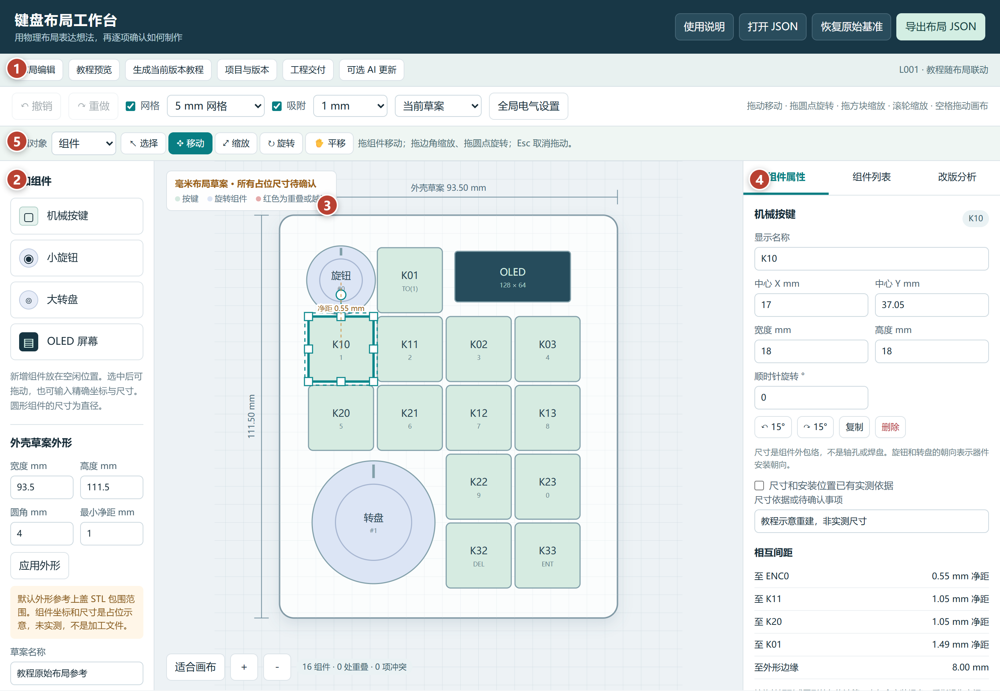
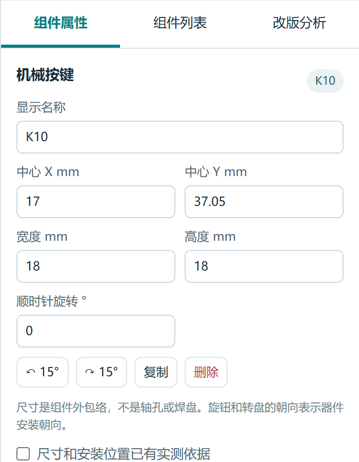
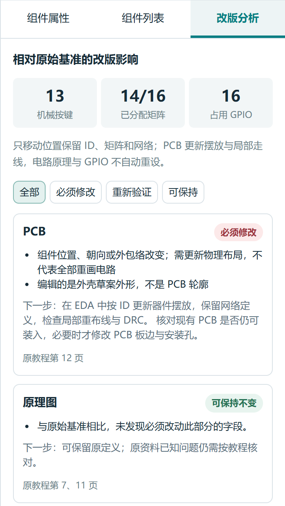
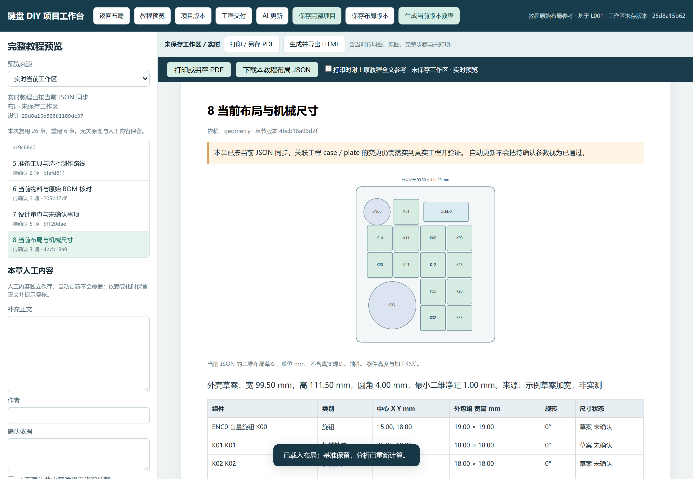
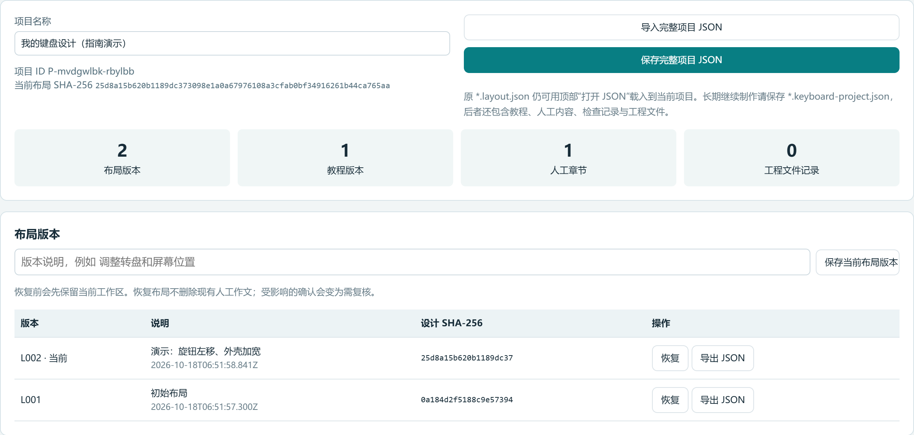
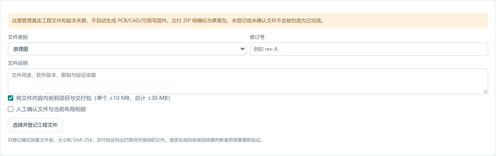

# 键盘 DIY 工作台使用指南

适用版本：工作台 2.0 · 指南修订：2026-10-18

本指南是统一操作说明。GitHub 图文、离线 HTML、PDF 以及编辑器内的“使用说明”均来自本文；旧版说明已清理，开发资料另见《维护开发说明》。插图取自实际运行的演示项目，尺寸、版本和哈希仅用于讲解。

## 01 · 第一次使用：先记住这条流程

**打开编辑器 → 调整布局 → 查看实时教程 → 保存完整项目 → 按需生成教程与交付包。**

1. 双击同目录的 **键盘布局编辑器.html**，建议用 Chrome 或 Edge 打开。无需安装、联网或启动服务器；主 HTML 单独复制也能运行。
2. 初始布局包括 13 个机械轴位、小旋钮、大转盘和 OLED。默认几何是未实测的占位草案。
3. 拖拽决定外观，再看“改版分析”和“教程预览”。不确定的尺寸、型号与参数继续留作待确认。
4. 打开“项目与版本”，用 **保存完整项目 JSON** 下载 `*.keyboard-project.json`。以后从这里的“导入完整项目 JSON”继续。

| 你想做什么                     | 使用哪个入口或文件                                   |
| ------------------------------ | ---------------------------------------------------- |
| 继续上次全部工作，或交给我分析 | **完整项目 `*.keyboard-project.json`，长期保存首选** |
| 只交换布局、尺寸和电气映射     | 顶部“导出布局 JSON” → `*.layout.json`                |
| 阅读某个设计版本的制作教程     | “生成当前版本教程” → HTML，再打印为 PDF              |
| 交给制作方审阅资料与缺项       | “工程交付” → 交付 ZIP 草案包                         |

**日常最重要的保存动作是“保存完整项目”。** 浏览器草稿只是补充，下载文件才是可靠备份。个人文件建议放在 `我的项目/`，避免与仓库示例混淆。

## 02 · 认识界面：五个区域

1. **页面导航**：布局编辑、教程预览、生成当前版本教程、项目与版本、工程交付、可选 AI 更新。
2. **左侧设计区**：添加按键、旋钮、转盘、OLED；设置外壳草案宽高、圆角与最小净距。
3. **中央画布**：选中、拖动、旋转、缩放，查看毫米网格和外形边界。
4. **右侧面板**：组件属性、组件列表、改版分析。先选中组件，才显示它的尺寸和硬件映射。
5. **画布工具栏**：撤销/重做、网格、吸附、原始布局对比、全局电气设置。

顶部“打开 JSON”和“导出布局 JSON”只交换布局；完整项目从“项目与版本”导入和保存。当前主 HTML 的“使用说明”会打开本指南的内嵌图文版。

## 03 · 拖拽设计：形状与电气分开改

1. **移动**：拖动组件，或填写右侧中心 X、Y。原点为外壳草案左上角，X 向右、Y 向下，单位 mm。
2. **旋转与缩放**：拖动上方圆点旋转，右下方方块缩放；也可填写宽、高、顺时针角度，按 Tab 或点击别处应用。旋转时按 Shift 吸附到 15°；圆形组件尺寸为直径。
3. **添加、复制、删除**：左侧添加，选中后在右侧复制或删除。新增或复制的输入不自动抢占原矩阵交点、编码器索引或 GPIO。
4. **外形与视图**：左侧填写宽高、圆角、最小净距，点“应用外形”。滚轮缩放；空格加拖动或中键拖动画布；“适合画布”恢复全景。网格和吸附步长可分别设置。

**组件 ID 是稳定身份。** 换位置时保留 ID，显示名称可以改。物理移动保留该组件的矩阵、GPIO 与四层键码。新增键可以先保持未分配，明确接线后再填写。

组件的输入、键码和规格在右侧修改；主控、矩阵、RGB 与工具链参数在“全局电气设置”修改。GPIO 填 F4、D1 等芯片端口名，不按开发板丝印猜测。外壳草案不能当成 PCB 板边。

## 04 · 检查间距与改版影响

选中组件可看最近四个组件的二维外包络净距和边缘距离。红色表示重叠或越界，小于最小净距会形成提示。虚线连接中心，但标注值仍是外包络间净距。

选择“叠加原始布局”，棕色虚线为基准。“只看原始基准”是只读视图，继续拖动前切回“当前草案”。“恢复原始基准”可撤销，只恢复布局，不清空整个项目。

| 变化               | 通常必须修改                       | 可以保留或需要复核                                 |
| ------------------ | ---------------------------------- | -------------------------------------------------- |
| 移动、旋转组件     | PCB 摆放与受影响走线、对应机械孔位 | 原理图网络、矩阵、GPIO 通常保留；验证 QMK 可视坐标 |
| 只改外壳外形       | 外壳模型                           | 验证 PCB、定位板能否装入，不自动要求改 PCB 板边    |
| 只改键码或旋转动作 | QMK 键位或编码器回调               | 原电路和机械通常保留                               |
| 新增按键           | 焊盘、孔位、BOM、固件输入          | 先验证空矩阵交点，不默认新增 GPIO                  |
| 改接线、引脚或主控 | 相应电路、PCB 网络与固件           | 外设引脚变化不等于全部矩阵重做                     |
| 补录型号、尺寸依据 | 更新资料和物料记录                 | 逐项判断是否实际换料                               |

“可保持不变”表示本次变化没有新增修改要求，**不代表原设计已经通过验证**。二极管方向、电源、UCAP/时钟、BOM 和旧 QMK 接口等原有问题仍会保留。二维碰撞和 GPIO 检查不能替代工程验证。

## 05 · 教程联动：选对预览来源

点击“教程预览”，把“预览来源”设为 **实时当前工作区**。完整教程包括 32 章、15 幅原项目参考图，以及当前布局图、尺寸与组件表、物料、接线、固件说明、制作顺序和验收。

布局变化后，可确定的数据自动同步，受影响的步骤和未知参数重新标记。固定原理和无关章节复用，不因移动一个键就重写全部电路。

| 预览来源       | 行为                                           |
| -------------- | ---------------------------------------------- |
| 实时当前工作区 | 跟随当前布局；可编辑人工内容和步骤记录         |
| 历史教程快照   | 生成当时的布局和正文，只读；后续修改不会改变它 |

**生成教程后会切到历史快照。** 再修改布局后若觉得“教程没变”，先切回“实时当前工作区”。左侧显示设计身份与章节复用情况。

原图是历史项目参考；每章可展开原教程全文，其中旧数量、尺寸与引脚不能直接当成当前设计的制作结论。

## 06 · 人工内容与确认：变化后保留并复核

在实时教程左侧选择章节，填写补充正文、作者与确认依据，点“保存并应用人工内容”。只有应用后才进入正文；未应用的编辑草稿也保存在完整项目里。

人工确认需要正文和依据。保存新稿时旧稿进入历史，可取回作为草稿。步骤可记录未完成、已记录完成、受阻和测量依据。

相关输入变化后，**人工正文和旧完成记录不丢失**，但会提示“需复核”。确认适用后再重新记录；工具不会自动替你确认。

几何尺寸确认、器件规格确认、人工文字确认和步骤完成互相独立。勾选一项不自动消除其他未知项，也不等于整个键盘具备加工条件。

## 07 · 保存、导入与恢复不同版本

1. 打开“项目与版本”，填写项目名称。
2. 在布局版本区填写说明，例如“调整转盘和屏幕位置”，点“保存当前布局版本”。L001 等是布局快照。
3. 回退时使用对应版本的恢复按钮。恢复前先保留当前设计；人工正文和教程历史不会清空，相关确认可能需复核。
4. 点击“保存完整项目 JSON”下载文件，建议文件名加日期。**保存快照后仍要下载完整项目备份。**
5. 下次点击“导入完整项目 JSON”继续；也可使用“恢复上次项目”或浏览器其他项目草稿。

同一设计复用布局版本；人工正文或步骤变化后仍可生成新的 T001 等教程版本，关联同一个布局版本。教程记录设计与正文 SHA-256，用于核对对应关系。

旧 `.layout.json` 从主页面顶部“打开 JSON”导入当前项目。它不含完整教程历史、人工记录、知识库与工程文件，不能替代完整项目备份。

## 08 · 生成制作教程 HTML 与 PDF

点击“生成当前版本教程”，固定当前布局与正文快照，下载独立 HTML。之后仍可修改当前项目，旧教程保持不变。

**导出 PDF：**

1. 在预览点击“打印 / 另存 PDF”，或打开已下载的教程 HTML 点击打印。
2. 打印目标选“另存为 PDF”，纸张选 A4。
3. 按需关闭浏览器自带页眉页脚，打开背景图形，检查预览后保存。
4. 默认打印当前制作内容；需要历史全文时，先勾选教程 HTML 顶部“打印时附上原教程全文参考”。

“生成当前版本教程”导出的是**键盘制作教程**；本《使用指南》解释的是**如何使用设计工具**。生成教程不会制板、采购、打印外壳、编译或烧录；固件内容是参数说明或配置片段，未经实际验证不能直接使用。

## 09 · 工程文件与制作交付包

“工程交付”管理原理图、PCB/Gerber、定位板、外壳/CAD、BOM、QMK/固件、测试证据与其他资料。多文件工程可先打包 ZIP 再登记。

1. 选择类别，填写修订、用途、软件版本与验证依据，再选择文件。
2. **内嵌**：单文件不超过 10 MB、合计不超过 30 MB，随完整项目与交付包保存。**仅登记**：读取文件计算哈希，保存文件名、大小和 SHA-256，不保存内容。
3. 实际验证相容后再勾选确认。布局变化后按类别复核；移动轴位影响 PCB/CAD，通常不改变原理图网络。
4. 点“生成并下载交付 ZIP”。导出会固定当前布局与教程版本，之后再保存完整项目，保留这些新记录。

ZIP 含项目、布局、教程 HTML、派生 BOM CSV、接线说明、manifest 及内嵌真实工程文件。仅登记文件明确列为“未包含”，需另交制作方。

包为交付草案，`readyForManufacture=false`。缺项和未确认信息会列出，不伪造 Gerber、STL、HEX 或验证结果。“复核并关联当前版”只是人工验证后的记录，不代替 ERC/DRC、编译和实物测试。

## 10 · 可选 AI：离线功能不依赖它

离线模板已能生成完整教程。需要补充解释时才使用 AI：选章节 → 导出 AI 更新请求 JSON → 交给所选服务 → 按《维护开发说明》协议取得响应 JSON → 导入并审核建议。普通聊天文字不能直接作为响应导入。

响应必须匹配项目、请求、布局哈希与章节依赖，过期响应拒绝。采用建议只追加人工待审核内容，不自动改变设计、引脚或确认状态，旧正文与历史保留。

默认不连接服务、不保存 API 密钥。自有适配器需开发者另行注册，点击后才调用；不要把密钥写进项目或分发的 HTML。

## 11 · 尺寸边界、快捷键和常见问题

默认外形 **93.5 × 111.5 mm** 参考原上盖 STL 包围范围，STL 不存单位，比例仍需实物确认；这不是 PCB 尺寸。

按键外包络默认 18 × 18 mm，节距参考 19.05 mm；小旋钮直径 19 mm、大转盘直径 34 mm、OLED 外包络 32 × 14 mm，都是拖拽占位。**OLED 的 128 × 64 是像素，不是毫米。**

二维检查不含焊盘、轴孔、轴座、螺柱、高度、板厚、插头、导线和手指空间。有真实依据后再记录与确认；移动几何后重新标为未确认。未知型号、封装、电压、地址、引导器和 QMK 提交继续留空或待确认。

| 操作              | 快捷键                          |
| ----------------- | ------------------------------- |
| 撤销 / 重做       | Ctrl+Z / Ctrl+Shift+Z 或 Ctrl+Y |
| 复制 / 删除       | Ctrl+D / Delete 或 Backspace    |
| 旋转              | R 顺时针 15°，Shift+R 逆时针    |
| 移动              | 方向键 1 mm，Shift+方向键 5 mm  |
| 取消选中          | Esc                             |
| 布局页 Ctrl+S     | 导出布局 JSON                   |
| 项目工作台 Ctrl+S | 保存完整项目 JSON               |

文本框保留常规编辑快捷键。撤销/重做保留本次会话最近 100 次修改；重开页面后靠 JSON 或草稿恢复。

**下载文件在哪里？** 由浏览器决定，查看下载记录；选择另存位置或移入 `我的项目/`，页面不能直接写入任意硬盘目录。

**重开又是原布局？** 点击“恢复上次项目”或导入完整项目。IndexedDB 不可用时尝试本地存储；清理缓存、无痕模式、路径改变或配额可能使草稿不可用。

**教程没跟着变？** 检查预览来源，切回“实时当前工作区”。**步骤完成还有未知项？** 完成记录不等于其他尺寸、电气与器件都已验证。

**JSON 导入失败？** 文件损坏、类型错误、基准改写、哈希不匹配或超限会被拒绝，并保留当前设计。项目从项目页导入，布局从顶部导入；不要手改基准或派生分析缓存。

上限为 200 个组件、100 个布局版本、100 个教程版本、100 条工程记录；布局 JSON 16 MB、完整项目 JSON 64 MB。先导出归档再另存项目，不自动删历史。

## 12 · 以后交给我或制作方的文件

**继续设计或请我分析：优先发送最新 `*.keyboard-project.json`。** 它包含背景、完整知识库与图片、布局/教程历史、人工正文与草稿、步骤记录及工程登记。

只讨论位置与尺寸可发 `.layout.json`；它含设计、原基准、规格、映射和分析缓存，但缺少完整项目上下文。无需重复发旧基准或 Schema。

交给制作方时提供交付 ZIP，补齐 manifest 未包含的工程文件、真实机械图、电气参数与验证证据。大文件未必内嵌在项目中，不能只凭项目 JSON 推定已经提供。

可附一句：“按当前布局继续分析，沿用已确认的主控和功能；先列待确认事项，再给 PCB、外壳、BOM 与 QMK 的具体修改步骤。”

默认无远程脚本、字体、统计或上传；选择本地文件用于导入和哈希计算。主动调用外部 AI 或分发文件时，数据才会离开本地。原视频、原教程 PDF 与附件未修改，也未纳入 GitHub 仓库。

## 附录 · 原始组件与硬件映射

以下只用于核对原始基准；当前连接以当前属性面板与制作教程为准。

组件 ID 是后续分析的稳定身份。不要为了换位置重命名 ID；显示名称可以自由修改。K00 没有独立轴体，它是 ENC0 小旋钮的按压输入。

| ID    | 硬件                | 矩阵位置                     | 原 Windows 层输出               |
| ----- | ------------------- | ---------------------------- | ------------------------------- |
| ENC0  | EC11 类小旋钮与按压 | r0c0 即 K00                  | 按下 KC_MUTE                    |
| K01   | 机械轴与热插拔座    | r0c1                         | TO(1) 切到 PR 层                |
| K02   | 机械轴与热插拔座    | r0c2                         | KC_3                            |
| K03   | 机械轴与热插拔座    | r0c3                         | KC_4                            |
| K10   | 机械轴与热插拔座    | r1c0                         | KC_1                            |
| K11   | 机械轴与热插拔座    | r1c1                         | KC_2                            |
| K12   | 机械轴与热插拔座    | r1c2                         | KC_7                            |
| K13   | 机械轴与热插拔座    | r1c3                         | KC_8                            |
| K20   | 机械轴与热插拔座    | r2c0                         | KC_5                            |
| K21   | 机械轴与热插拔座    | r2c1                         | KC_6                            |
| K22   | 机械轴与热插拔座    | r2c2                         | KC_9                            |
| K23   | 机械轴与热插拔座    | r2c3                         | KC_0                            |
| K32   | 机械轴与热插拔座    | r3c2                         | KC_DEL                          |
| K33   | 机械轴与热插拔座    | r3c3                         | KC_ENT                          |
| JOG1  | AN_zippy 类大转盘   | 旋转与 F0 直连按压，不占矩阵 | 顺时针 KC_LEFT，逆时针 KC_RIGHT |
| OLED0 | I²C 128×64 屏幕     | 不占矩阵                     | 显示当前层图标                  |

原矩阵行脚：r0=F4、r1=F5、r2=F6、r3=F7。原列脚：c0=B6、c1=B5、c2=B4、c3=D7。因此每个矩阵输入的硬件端口均能由行列位置推导。r3c0 和 r3c1 是原固件的两个空位，不代表 PCB 上已预留对应焊盘。

ENC0 旋转：index 0，A=C7、B=C6，公共端 GND；顺时针音量加，逆时针音量减。按压走 r0c0。

JOG1 旋转：index 1，A=D6、B=D4，公共端 GND；按压 NO 接 F0、COM 接地。原固件只定义 F0，未实现按压读脚、去抖和发送空格，因此 `implemented=false`。界面勾选“已实现”只是记录状态，不会自动生成或烧录程序。

OLED0：SDA=D1、SCL=D0；原 JP1 编号 1=SDA、2=SCL、3=GND、4=+5V。不能按排针外观直插，模块电压和信号顺序另行核对。原固件图像旋转 180°。

13 个机械轴位的 RGB 标记对应原 13 节点数据链，数据脚 F1。新增按键默认不带 RGB；勾选灯珠不会悄悄更改全局数量，需要在“全局电气设置”中核对。

四层的完整键码保存在每个组件的 `keycodes` 中，并可在属性面板查看修改；不是只存 Windows 层。原快捷键按旧源码保留，迁移到当前 QMK 时仍需核对 API 和键码名称。

GPIO 检查针对记录的信号与 ATmega32U4 通用端口名，不是完整复用、时序、电流能力检查。换主控、总线、特殊输入或扩展层数，需要扩展模型并工程验证，不能只改名称就视为适配。

布局 JSON 的 `design` 是当前设计，`referenceBaseline` 是完整原基准，`sourceContext` 记录单位与来源，`analysis` 是导入时重算的派生缓存。Schema 验证通用结构，唯一 ID、行列范围、引脚数组配对和圆形等宽高等跨字段规则由程序额外检查；未知规格用 null，不填猜测值。
